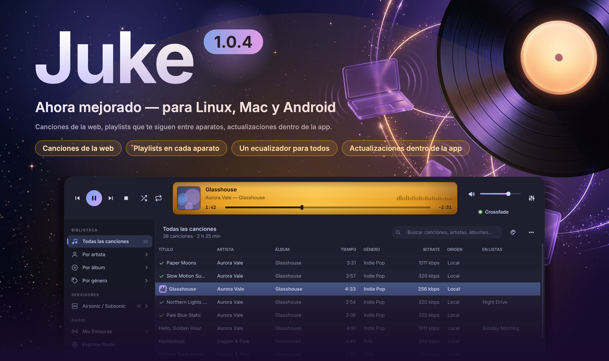

<div align="center">



<br>

**Juke, ahora mejorado.**<br>
Arma tus playlists con canciones de la web y de tu música — y tócalas en Linux, Mac y Android.

<br>

[English](README.md) · **Español**

<br>


[**Descargar**](https://github.com/vezzulab/juke/releases/latest) &nbsp;·&nbsp; [**Manual**](https://vezzulab.github.io/juke/manual.html) &nbsp;·&nbsp; [Sitio web](https://vezzulab.github.io/juke/) &nbsp;·&nbsp; [Reportar un problema](https://github.com/vezzulab/juke/issues)

</div>

<br>

## Novedades de la 1.0.4

- **Canciones de la web.** Busca cualquier canción o artista y escucha solo su audio — sin video, sin anuncios y sin descargar nada. Si buscas un artista, sale todo su repertorio. Añade lo que te guste a una playlist y tócala después sin volver a buscar. En Linux, Mac y Android.
- **Playlists que te siguen.** Tus playlists, emisoras de radio y algunos ajustes se mantienen iguales en Linux, Mac y Android por sí solos — con lo que cambias y lo que borras. La copia va cifrada con un código que solo tú tienes.
- **Playlists en Android.** Una pestaña nueva, *Listas*, con caja de búsqueda y orden a elegir (por nombre, más recientes, más canciones). Las canciones que el teléfono no tiene salen en gris.
- **Actualizaciones dentro de cada app.** En una Mac, *Actualizar ahora* instala la Juke nueva por sí sola, como ya hacía en Linux y Android.

Todo lo demás — cada función, cada atajo — está en el [manual](https://vezzulab.github.io/juke/manual.html) (dentro de la app: `F1` en Linux y Mac, *Ajustes ▸ Manual* en Android).

## Instalar

**Linux** — descarga `Juke-x86_64.AppImage` de la [última versión](https://github.com/vezzulab/juke/releases/latest) y luego:

```sh
chmod +x Juke-x86_64.AppImage
./Juke-x86_64.AppImage
```

Necesita Linux x86_64 con glibc 2.35 o más nueva (Ubuntu 22.04, Debian 12, Fedora 36+) y FUSE 2. Todo lo demás va dentro del archivo.

**Mac** — descarga `Juke-macos-arm64.dmg` de la misma página, ábrelo y arrastra **Juke** a **Aplicaciones**. Para Macs con chip de Apple (M1 y posteriores) y macOS 15 o más nuevo; todo lo demás va dentro de la app.

Juke no está firmado con un certificado de desarrollador de Apple de pago, así que la primera vez macOS dice que no puede verificar la app. Abre *Ajustes del Sistema ▸ Privacidad y seguridad*, baja hasta *Seguridad* y pulsa **Abrir de todos modos** junto a Juke. Solo se hace una vez. Desde la terminal: `xattr -dr com.apple.quarantine /Applications/Juke.app`.

**Android** — descarga `Juke-1.0.4.apk` de la misma página (Android 8 o más nuevo).

Juke te avisa cuando sale una versión nueva, o pulsa *Buscar actualizaciones…* en el menú o en *Ajustes ▸ General*.

## Privacidad

Sin telemetría, sin cuentas, sin analíticas. Solo se conecta a lo que usas: tu servidor, las emisoras, las canciones de la web (solo cuando las buscas o las tocas), el servidor de sincronización (solo si configuras la sincronización), los servicios de letras, pypi.org (solo si buscas en la web desde la computadora, para mantener esa parte al día) y GitHub para buscar actualizaciones (se puede apagar). Los detalles están en el manual.

## Licencia

Gratis para cualquier uso en tus propios aparatos. No se puede modificar ni redistribuir: comparte las [descargas oficiales](https://github.com/vezzulab/juke/releases). Términos completos en la [Licencia Juke 1.0](LICENSE); el software de terceros incluido conserva su propia licencia ([NOTICE.md](NOTICE.md)).
