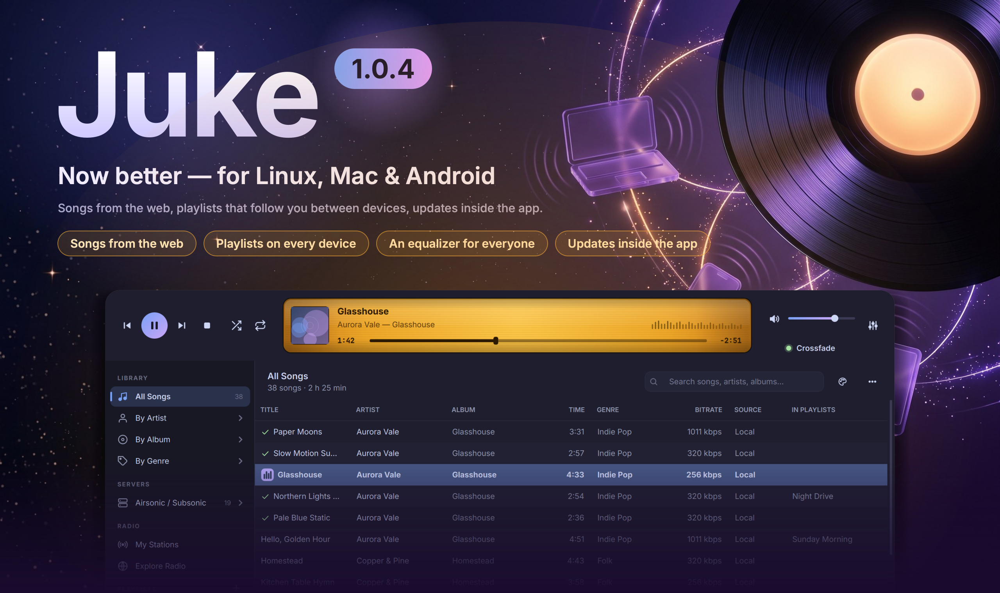

<div align="center">



<br>

**Juke, now better.**<br>
Make playlists with songs from the web and your own music — and play them on Linux, Mac and Android.

<br>

**English** · [Español](README.es.md)

<br>


[**Download**](https://github.com/vezzulab/juke/releases/latest) &nbsp;·&nbsp; [**Manual**](https://vezzulab.github.io/juke/manual.html) &nbsp;·&nbsp; [Website](https://vezzulab.github.io/juke/) &nbsp;·&nbsp; [Report a problem](https://github.com/vezzulab/juke/issues)

</div>

<br>

## New in 1.0.4

- **Security update.** Stricter checks on every download and update, a safer default for server addresses, and a faster, lighter Android app.
- **Songs from the web.** Search any song or artist and play just its audio — no video, no ads, nothing downloaded. Search an artist and you get the whole repertoire. Add what you like to a playlist and play it later without searching again. On Linux, Mac and Android.
- **Playlists that follow you.** Your playlists, radio stations and a few settings stay the same on Linux, Mac and Android by themselves — edits and deletions too. The copy is encrypted with a code only you have.
- **Playlists on Android.** A new *Playlists* tab with a search box and a choice of order (by name, most recent, most songs). Songs the phone does not have show greyed.
- **Updates inside every app.** On a Mac, *Update now* installs the new Juke by itself, as it already did on Linux and Android.

Everything else — every feature, every shortcut — is in the [manual](https://vezzulab.github.io/juke/manual.html) (inside the app: `F1` on Linux and Mac, *Settings ▸ Manual* on Android).

## Install

**Linux** — download `Juke-x86_64.AppImage` from the [latest release](https://github.com/vezzulab/juke/releases/latest), then:

```sh
chmod +x Juke-x86_64.AppImage
./Juke-x86_64.AppImage
```

Needs x86_64 Linux with glibc 2.35 or newer (Ubuntu 22.04, Debian 12, Fedora 36+) and FUSE 2. Everything else is inside the file.

**Mac** — download `Juke-macos-arm64.dmg` from the same page, open it and drag **Juke** onto **Applications**. For Macs with Apple chips (M1 and later) and macOS 15 or newer; everything else is inside the app.

Juke is not signed with a paid Apple developer certificate, so the first time macOS says it cannot check the app. Open *System Settings ▸ Privacy & Security*, scroll down to *Security* and press **Open Anyway** next to Juke. You only do it once. From the terminal: `xattr -dr com.apple.quarantine /Applications/Juke.app`.

**Android** — download `Juke-1.0.4.apk` from the same page (Android 8 or newer).

Juke tells you when a new version is out, or press *Check for updates…* in the menu or in *Settings ▸ General*.

## Privacy

No telemetry, no accounts, no analytics. It only connects to what you use: your server, radio stations, songs from the web (only when you search them or play them), the sync server (only if you set up sync), lyrics services, pypi.org (only if you search the web on the computer, to keep that part current) and GitHub to look for updates (switchable). Details are in the manual.

## License

Free to use for any purpose on your own devices. It may not be modified or redistributed: share the [official downloads](https://github.com/vezzulab/juke/releases) instead. Full terms in the [Juke License 1.0](LICENSE); included third-party software keeps its own licence ([NOTICE.md](NOTICE.md)).
